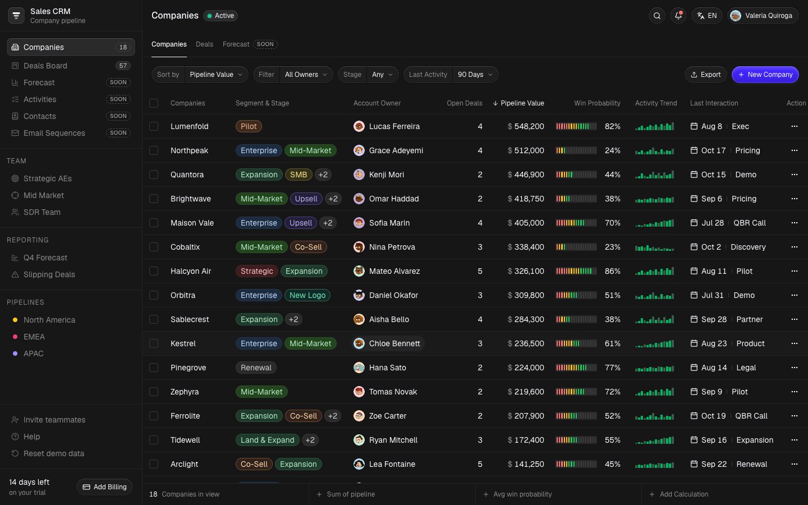
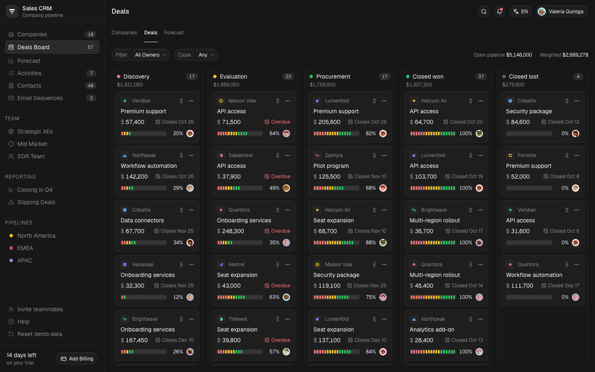
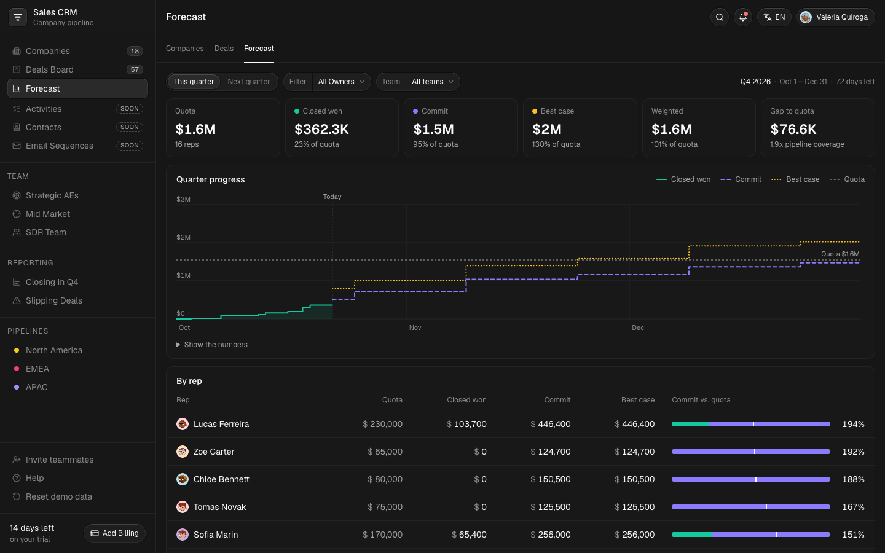
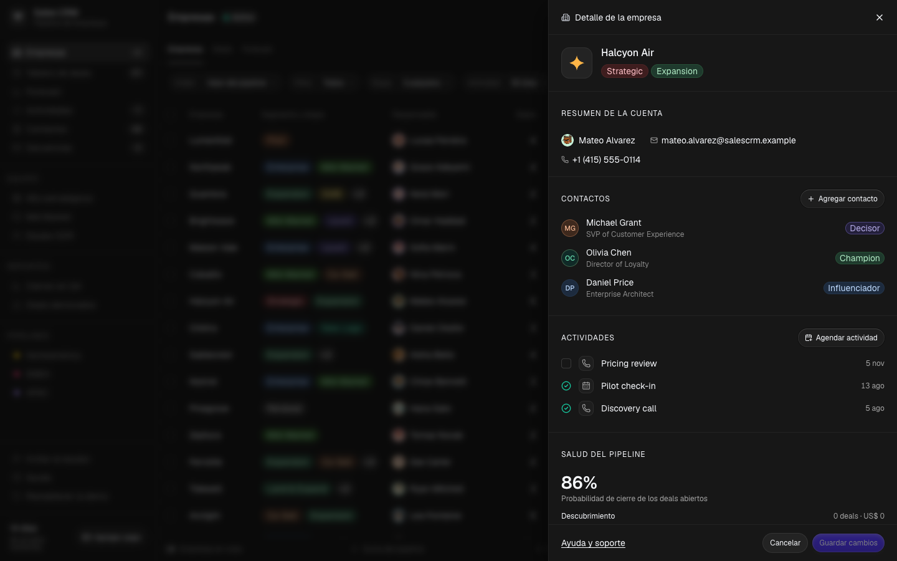
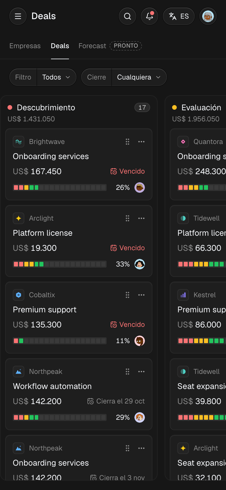

# Sales CRM

[English](README.md) · **Español**

CRM de cuentas para equipos de ventas B2B: pipeline de empresas, tablero de deals con arrastrar y soltar, forecast trimestral, vistas guardadas y búsqueda. Funciona completo en el navegador, en inglés y español.

**Demo en vivo:** [salescrm.thomalabs.com](https://salescrm.thomalabs.com)







<p>
  
  
</p>

## Qué tiene

- **Tabla de empresas.** Orden por cinco criterios (desde el menú o los encabezados) y filtros por responsable, segmento o etapa, y días desde la última interacción. Se pueden seleccionar filas para reasignarlas o eliminarlas con opción de deshacer, exportar a CSV y sumar cálculos en vivo al pie de la tabla.
- **Tablero de deals.** Los deals se arrastran entre etapas con mouse, touch (manteniendo presionado) o teclado, con anuncios para lectores de pantalla. Un menú "Mover a" hace lo mismo sin arrastrar. Los deals abiertos, el valor del pipeline y la probabilidad de cierre de cada empresa se calculan a partir de sus deals, así que mover una tarjeta actualiza la tabla.
- **Forecast.** El trimestre actual o el próximo, para todo el equipo, un equipo o un vendedor: cuota, ganado, Commit, Best case, pipeline ponderado y cobertura, un gráfico del avance del trimestre (con sus números en una tabla) y el detalle por vendedor. Desde la lista, cada deal puede cambiar de categoría o pasar al próximo trimestre, con opción de deshacer.
- **Detalle del deal.** Al hacer clic en un deal se abre una ficha para editar el monto, la fecha de cierre, la etapa, la probabilidad y la categoría de forecast. Antes de guardar muestra dónde va a contar en el forecast. Todas las vistas se actualizan: tablero, tabla de empresas y forecast.
- **Vistas guardadas.** Los ítems del sidebar son filtros reales: equipo, región, deals que cierran este trimestre y deals demorados.
- **Inglés y español.** Rutas `/en` y `/es`, detección del idioma del navegador, moneda, fechas y plurales con el formato de cada idioma, metadata traducida con `hreflang` y claves de traducción verificadas por TypeScript.
- **URLs para compartir.** Los filtros, el orden y la empresa abierta viven en la URL (`/es/deals?owner=kenji-mori&company=quantora`).
- **Persistencia.** Los cambios se guardan en el navegador. En cada visita las fechas se corren hacia adelante, así la demo nunca se ve vieja. "Restablecer la demo" se puede deshacer.
- **Accesibilidad.** Cero violaciones de WCAG 2.1 AA según axe-core, verificado en CI en los dos idiomas. Soporte de teclado en todo, alternativa al arrastre en el tablero (WCAG 2.5.7) y respuestas 404 reales.

## Stack

Next.js 16 (App Router, páginas estáticas, `proxy.ts`) · React 19 · TypeScript (strict) · Tailwind CSS v4 · Radix UI · next-intl · dnd-kit · cmdk · Zustand · Sonner · Vitest · Playwright · axe-core

## Cómo está armado

```
src/
  app/[locale]/        rutas por idioma: empresas (/), tablero (/deals), 404
  i18n/                routing, configuración por request, mensajes tipados
  messages/            en.json, es.json
  proxy.ts             redirige / al idioma del visitante
  components/
    ui/                primitivas sobre Radix (dialog, sheet, menús, select, tabs…)
    crm/
      shell/           layout, sidebar, header, búsqueda, notificaciones, esqueletos
      companies/       tabla, toolbar, pie, acciones masivas
      deals/           tablero, tarjetas, menú de etapas
      forecast/        indicadores, gráfico del trimestre (SVG), vendedores, deals por categoría
      sheets/          detalle de empresa y de deal, perfiles, alta de empresa
  lib/                 lógica de dominio como funciones puras (+ __tests__)
e2e/                   specs de Playwright (desktop + mobile, accesibilidad)
```

Algunas decisiones:

- **La lógica de dominio es pura y está testeada.** Filtros, orden, métricas, forecast, búsqueda, validación, CSV, lectura de la URL y persistencia viven en `src/lib` sin React, y 108 tests unitarios los cubren directamente.
- **La URL es el estado de todo lo que se comparte.** Los filtros y la empresa abierta se leen con `useSearchParams` y se escriben con `history.replaceState`, que Next.js sincroniza sin navegar. Zustand guarda los registros y el estado de la interfaz, como la selección y los diálogos abiertos.
- **Las fechas son relativas al día del visitante.** Los datos de ejemplo se definen como "hace N días". Los datos guardados registran la fecha en que se guardaron y se corren al cargarlos.
- **El forecast se sostiene cualquier día.** Los deals ganados de ejemplo siguen el ritmo que predice el pipeline abierto de cada cuenta. Al principio del trimestre casi todo el forecast está abierto y al final casi todo está ganado, pero los totales quedan en un lugar parecido. Un test unitario lo verifica con varias fechas.
- **HTML estático, datos en el cliente.** Las páginas se prerenderizan con esqueletos, porque los datos viven en el navegador. Igual se renderizan en el servidor, así que `notFound()` devuelve un `404` real.
- **Las traducciones se verifican.** Un test unitario falla si al español le falta una clave, usa otros placeholders, tiene sintaxis ICU inválida o quedó sin traducir por error.

## Correr el proyecto

Requiere Node 22.12 o superior.

```bash
npm install
npm run dev        # http://localhost:3000
```

| Script | Para qué |
| --- | --- |
| `npm run build` / `npm start` | Build de producción, servido igual que en la imagen de Docker |
| `npm test` | Tests unitarios (Vitest) |
| `npm run test:e2e` | Tests end-to-end contra el build de producción (Playwright). Ejecutar una vez `npx playwright install chromium`, o usar un Chrome instalado con `PW_CHANNEL=chrome`. Con `E2E_BASE_URL` se testea un sitio desplegado. |
| `npm run lint` / `npm run typecheck` | ESLint y TypeScript |
| `npm run avatars` | Regenera los avatares SVG |

GitHub Actions corre lint, typecheck y los tests unitarios y end-to-end en cada push, y además construye la imagen de Docker y la prueba.

## Despliegue

La demo en vivo corre en un VPS con [Dokploy](https://dokploy.com), que la reconstruye en cada push a `main`.

- **Docker / Dokploy (self-hosted).** El `Dockerfile` multi-etapa construye el servidor standalone de Next.js y lo corre con un usuario sin privilegios y con health check. El contenedor escucha en el puerto `3000`. La URL pública se pasa como argumento de build, porque las páginas estáticas la incluyen en sus etiquetas canonical, `hreflang` y Open Graph:

  ```bash
  docker build --build-arg SITE_URL=https://crm.example.com -t sales-crm .
  docker run -p 3000:3000 sales-crm
  ```

- **Vercel.** Funciona sin configuración; la URL de producción se detecta sola.

## Créditos

- La interfaz se basa en [Sales CRM de Kargul Studio](https://sales-crm-kargulstudio.vercel.app/). El código, los datos, los logos y los avatares de este repositorio son propios, y el tablero de deals, el forecast, la versión en español, la persistencia, las vistas guardadas y las acciones masivas son nuevos.
- Avatares: estilo "Adventurer" de Lisa Wischofsky ([CC BY 4.0](https://creativecommons.org/licenses/by/4.0/)), generados con [DiceBear](https://www.dicebear.com/).
- Íconos: [Lucide](https://lucide.dev/) (ISC). Tipografía: [Geist](https://vercel.com/font) (SIL OFL).
- Las empresas, las personas, los emails (`.example`) y los teléfonos (555-01xx) son ficticios.
